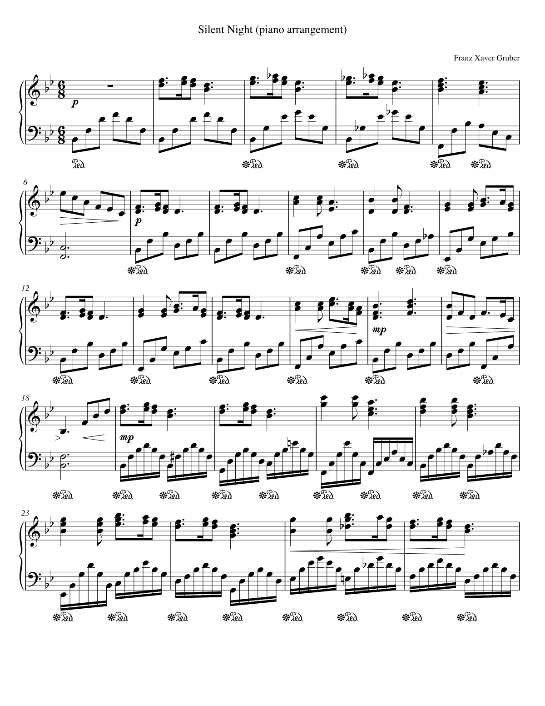

# music-ai

Experiments in AI for music, done in public as a learning project. Each track is a different
problem in music AI, worked from the literature up, with an experiment write-up for every run.

| Track | Question | Status |
| ----- | -------- | ------ |
| [Generation](#generation) | Can LLMs write advanced solo-piano arrangements of songs I know, as symbolic notation? | Main focus now: experiments 001–004 |
| [Optical music recognition](#optical-music-recognition) | Can a model read photos of printed scores into symbolic notation? | Planned |
| [Audio transcription](#audio-transcription) | Can a model turn recordings into notation? | Planned |

Where the tracks meet: they all target the same text formats (see [Notation formats](#notation-formats)),
and OMR and transcription could later feed the arranger with melodies from hymnals, lead sheets
and recordings. Goals and stages are in [ROADMAP.md](ROADMAP.md).

## Generation

The aim is arrangements I'd want to practise and perform: Christmas hymns first, then pop songs
and music for ballet classes. Every piece is checked automatically and then **judged by me at the
piano**, blind where the design allows, and every judgment is saved as data. The long-term aim is
an open-weight model fine-tuned on that feedback; for now I prompt hosted models, which is the
quickest way to learn what's possible, build the evaluation tools, and find out what good output
looks like.

### Listen

Three generated pieces, one from each finished experiment, rendered by
[`scripts/render_scores.py`](scripts/render_scores.py) (beams added, notes unchanged):

| Piece | Experiment | What it shows | Score | Audio |
| ----- | ---------- | ------------- | ----- | ----- |
| 8-bar keyboard-style cadence exercise, C major | [001](experiments/001-gen-abc-vs-kern-pilot/) | Theory docs only: correct, but "like out of a textbook" (musicality 2/5) | [PDF](experiments/001-gen-abc-vs-kern-pilot/renders/kern-T1.pdf) | [MP3](experiments/001-gen-abc-vs-kern-pilot/renders/kern-T1.mp3) |
| Chopin-style prelude, G minor | [002](experiments/002-gen-real-excerpts/) | With real Chopin excerpts in context; my favourite of its task (musicality 5/5) | [PDF](experiments/002-gen-real-excerpts/renders/B-T1-1.pdf) | [MP3](experiments/002-gen-real-excerpts/renders/B-T1-1.mp3) |
| *Silent Night* arrangement | [003](experiments/003-gen-hymn-arrangements/) | Best of ten hymn arrangements; playable "with fixes", easier than the brief asked | [PDF](experiments/003-gen-hymn-arrangements/renders/H4-2.pdf) | [MP3](experiments/003-gen-hymn-arrangements/renders/H4-2.mp3) |

[](experiments/003-gen-hymn-arrangements/renders/H4-2.pdf)

The audio is MuseScore's default piano playing the MIDI, so it's mechanical; the judging was done
at a real piano.

### Experiments

Each experiment folder has a README with the question, setup (model, prompt, context, commit),
results, error analysis and takeaways.

| # | Question | Result |
| - | -------- | ------ |
| [001](experiments/001-gen-abc-vs-kern-pilot/) | Do LLMs write better piano scores in ABC or `**kern`? (pilot) | No format effect: 8/8 valid, preferences split 2–2. Output was correct but bland, and the blandness traced back to my own context docs (a root-position rule written for keyboard drills). |
| [002](experiments/002-gen-real-excerpts/) | Do short excerpts of real composers in context make the pieces more idiomatic? | Yes in this run: blind musicality 3.9 → 4.9 of 5 (24 pieces, p ≈ 0.001 by permutation test; one rater, near the ceiling). Also exposed misspelled pitches the validator missed and missing beams. |
| [003](experiments/003-gen-hymn-arrangements/) | Can the setup produce a hymn arrangement I'd actually play? | Not yet: 10/10 valid with the tune intact, none playable as is, and difficulty 2–3 instead of advanced. All ten followed the same plan, which my arranging guide had prescribed; I rewrote the guide from my notes. |
| [004](experiments/004-gen-planned-arrangement/) | Does writing from a plan I approve first, with Liszt's transcriptions studied as references, fix what 003 lacked? | In progress: two *Silent Night* arrangements generated and checked; my judging is pending. |

A recurring finding: the models copy whatever the context shows, so the context documents
themselves are the main thing being tested.

### How it works

1. **Context.** Hand-written reference docs in [`experiments/generation/`](experiments/generation/):
   tonal harmony, piano styles, an encoding reference for each notation format, an arranging and
   planning guide, and notes on how Liszt arranged songs for piano, with bar references.
2. **Generation.** A fresh LLM agent per piece gets a brief plus a fixed set of those docs (and, from
   002, short excerpts of real music) and writes one score as text. Exact prompts are in each
   experiment folder.
3. **Automatic checks.** Parsing and bar durations (music21, Verovio), pitch spelling, voice
   leading, hand span and leaps, copying from the excerpts, and whether the tune is actually
   present (`music_ai.melody_fidelity`, `music_ai.melody_map`). These catch errors; they don't
   score quality.
4. **Judging.** I play the pieces from rendered scores and rate fit to the brief, musicality,
   playability and difficulty, with written notes and a favourite per brief.
5. **Feedback data.** Generations, ratings and preferences go into [`feedback/`](feedback/README.md)
   as JSONL, with the brief, context, model and commit for each piece.

Corpus statistics (inversions, non-chord tones, spans) are computed for comparison with real
composers, but only to describe style. They are never generation targets.

## Notation formats

Every track works in plain-text symbolic notation:

- [**Humdrum `**kern`**](https://www.humdrum.org/rep/kern/): one column ("spine") per staff, one
  row per moment in time. Tabular and explicit about timing, and the format of most scholarly
  music corpora. The generation experiments use it from 002 on.
- [**ABC**](https://abcnotation.com/): compact notation, common on the web for folk tunes.

MusicXML and MIDI are conversion targets, produced from validated text, never emitted by a model
directly.

## Optical music recognition

Turning photos and scans of printed sheet music (any instrumentation) into `**kern` or ABC. The
plan follows the current end-to-end approach in the literature (Legato, Transcoda, Sheet Music
Transformer): a pretrained vision encoder, an autoregressive text decoder, and grammar-constrained
decoding so outputs are always valid. The data curriculum goes from Camera-PrIMuS (single-staff
incipits with simulated camera distortion) to GrandStaff (piano scores), synthetically rendered
OpenScore Lieder, and finally real photos. Evaluation uses OMR-NED from the Sheet Music Benchmark
and CER, with Audiveris as the baseline to beat. The evaluation harness comes before any training.

## Audio transcription

Turning audio recordings into notation. Not started yet.

## Repository layout

```
experiments/NNN-slug/   one folder per experiment (NNN-gen-* for generation): README, prompt,
                        samples, renders
experiments/generation/ context docs (theory, styles, encoding, arranging), hymn sources, and
                        the notation, harmony and playability checkers with their tests
src/music_ai/           library code: kern reader, beaming, melody fidelity and phrase mapping,
                        style statistics, MusicXML-to-kern conversion checks, feedback tables
scripts/                downloads, conversion, rendering, and per-experiment eval scripts
tests/                  pytest tests for src/music_ai
feedback/               my ratings and preferences (JSONL); see its README
```

Local-only and gitignored: `data/` (corpora, excerpts, my own arrangements, my written rating
notes), `outputs/` (eval results), `notes/` and `research/` (my notebook and paper PDFs).
Copyrighted music is referenced by file and bar range and never committed; the hymn sources are
public domain.

## Setup

Requires [uv](https://docs.astral.sh/uv/) and Python 3.12.

```sh
uv sync
uv run pytest                          # library tests
uv run pytest experiments/generation   # checker tests
uv run experiments/generation/validate_notation.py experiments/003-gen-hymn-arrangements/samples/H4-2.krn
```

Rendering with `scripts/render_scores.py` also needs `rsvg-convert` (librsvg) and MuseScore 4.
Most experiment eval scripts need the corpora in `data/`, which the `scripts/fetch_*.py` scripts
download.


## License

All rights reserved; see [LICENSE](LICENSE). The repo is public for reading, not for reuse. The
public-domain hymn sources are excepted.
